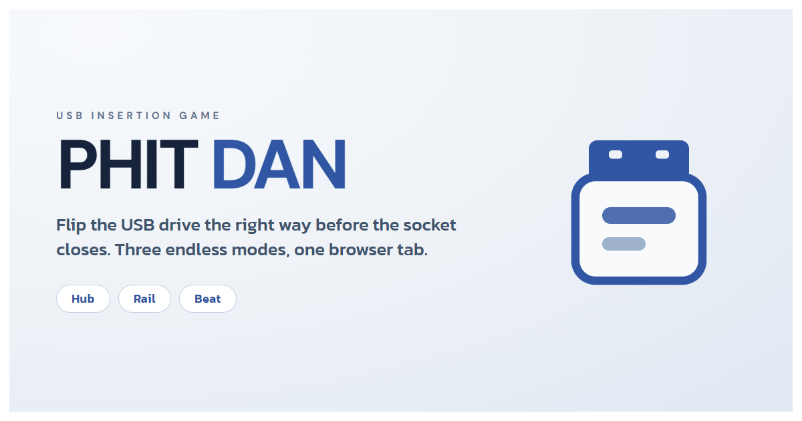
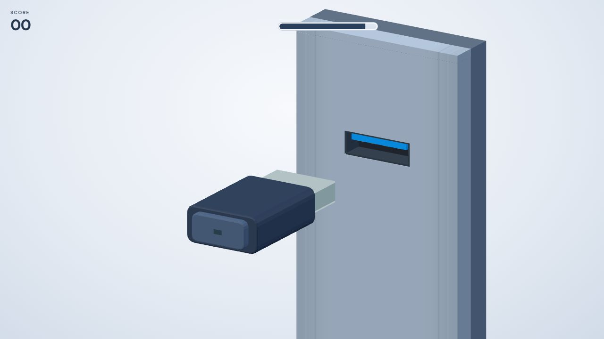
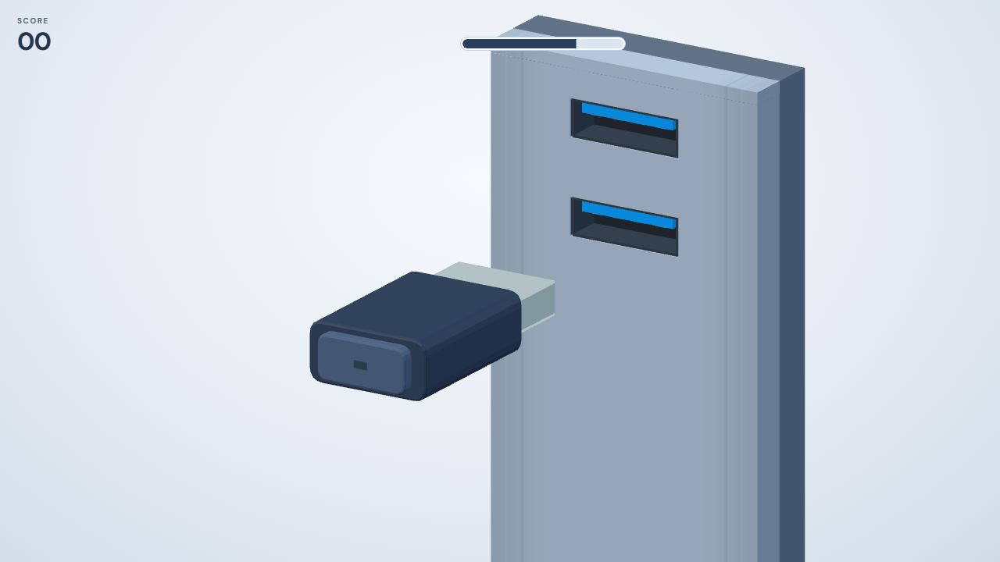
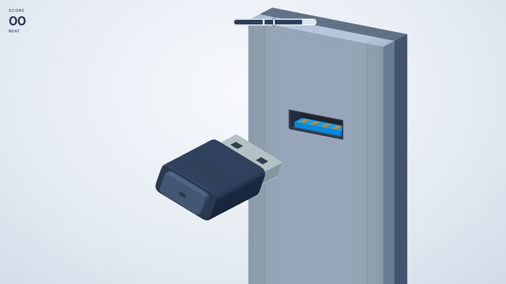
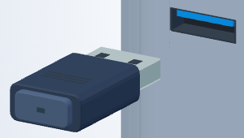
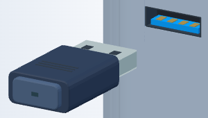

# PHIT DAN



**A little game about the universal challenge of plugging in a USB drive.**
Flip the connector into the right orientation, beat the clock, and see how long
you can keep your streak going. PHIT DAN is a free, browser-based 3D arcade game
with three endless modes.

## Gameplay screenshots

| Hub | Rail | Beat |
| :---: | :---: | :---: |
|  |  |  |

These images show the game running in each mode. Timers were extended in a
separate preview copy to make the screenshots possible.

## Contributors and acknowledgements

- **Ompaemapoot** — project owner and copyright holder.
- **OpenCode** — AI-assisted development and local testing.
- **Three.js contributors** — the 3D library used by the game.

OpenCode is credited here as a development tool; GitHub's automatic Contributors
list is based on commit attribution to GitHub accounts.

## How to play

1. Enter a player name and select **Play**.
2. Choose **Hub**, **Rail**, or **Beat**.
3. Look at the marks on the USB connector and the gold contacts in the socket.
   If both are visible, or both are hidden, the orientation is ready. If only
   one is visible, flip the connector.
4. **Tap or click the game area, or press Space** to flip. In Hub and Rail,
   insertion happens automatically when the bar runs out. In Beat, act again
   to time the insertion.
5. Keep inserting correctly to increase your score. A mistake ends the run;
   choose **Play again** to try once more.

| Flip | Ready |
| :---: | :---: |
|  |  |
| Only one set of marks is visible. | Both sets of marks are visible. |

## Game modes

| Mode | How it plays |
| --- | --- |
| **Hub** | Adapt to changing socket layouts as your score grows. Later rounds can shift the target socket. |
| **Rail** | React to a continuous row of horizontal sockets. The pace increases as you score. |
| **Beat** | Flip before time runs out, then tap, click, or press Space again when the moving marker reaches the **GOOD** or **PERFECT** zone. Perfect streaks earn a bonus. |

Each mode has its own leaderboard on your device. The progress bar shows the
time remaining, and the light on the USB turns green for a correct insertion or
red for a mistake.

## Run locally

You need a modern browser and a local static server. For example, from the
repository folder with Python installed:

```sh
python -m http.server 8000 --bind 127.0.0.1
```

Open <http://localhost:8000/>. There is no build step. The game works on desktop
and mobile browsers; on touch devices, play is limited to portrait orientation.
See [README-GAME.md](README-GAME.md) for more detail and optional phone testing
instructions.

## Features and local data

- Three endless modes with separate local leaderboards.
- Optional sound and score-linked player messages, with controls in Settings.
- Share the game link or download a score image after a run.
- Pause on interruption, then resume when you are ready.
- Self-hosted game assets, Three.js, and fonts; no application server or account
  is required to play.

Player names, scores, messages, and settings stay in the browser's local storage.
They are not a shared online leaderboard. **Settings → Clear my data** removes
this game's saved data from the current browser. Sharing is initiated by the
player and uses the device's sharing or clipboard features when available.

## Development

The game uses JavaScript, HTML, CSS, and the locally bundled Three.js renderer.
With Node.js installed, run the files in `tests/` to check the game; for example:

```sh
node tests/gameplay-balance.cjs
```

The optional `transition-preview.html` page compares early transition ideas and
is separate from the playable game.

## License

The game source is available under the MIT License; see `LICENSE` at the
repository root. The bundled Three.js library has its own MIT notice in
`vendor/THREE-LICENSE.txt`. DM Sans and Kanit are distributed under the SIL Open
Font License; their notices are in `assets/fonts/`.
